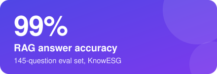
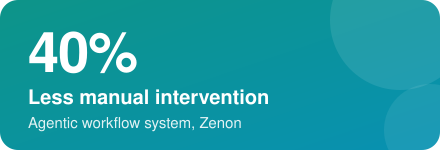
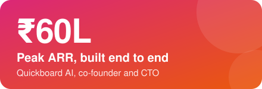
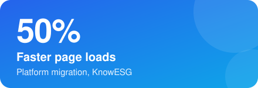

  

  
  
  

## About me

I build production GenAI systems and ship the products around them. My work covers RAG assistants with cited sources, AI agents, NL2SQL engines and MCP servers, with evals and guardrails built in from the start.

- **Now:** Product Manager at **LiveSwitch**, leading the web and mobile platform and still writing production code
- **Founder:** co-founded **Quickboard AI**, a D2C analytics platform, and built it end to end
- **Before:** Software Engineer at **Zenon** (agentic workflows, NL2SQL) and **KnowESG** (RAG assistant, semantic search, MCP servers)
- **Research:** co-author of a published NLP paper on sarcasm detection

## Results from shipped work

  
  

  
  

The RAG assistant also scored 0.95 on faithfulness, refused 100% of prompt-injection attempts, and had its median latency cut from 9.4 s to 3.4 s.

## Tech stack

**AI and LLMs**

**Backend and data**

**Frontend and platform**

## Featured projects

<table>
  <tr>
    <td width="50%" valign="top">
      <h3><a href="https://github.com/UditKaushish/inquira">inquira</a></h3>
      
Open-source AI analytics copilot. Ask a question in plain English and get validated, read-only SQL, a chart and an answer, streamed from your own warehouse.

      

      

    </td>
    <td width="50%" valign="top">
      <h3><a href="https://github.com/UditKaushish/slash-prompt">slash-prompt</a></h3>
      
A <code>/prompt</code> command for Claude Code and Codex CLI that turns a rough request into a clear, structured prompt without changing its meaning.

      

      

    </td>
  </tr>
  <tr>
    <td width="50%" valign="top">
      <h3><a href="https://github.com/UditKaushish/arogo">arogo</a></h3>
      
Question answering over medical textbooks. Hybrid BM25 and sentence-transformer retrieval, cross-encoder re-ranking, a Flask API and a Next.js frontend.

      

      

    </td>
    <td width="50%" valign="top">
      <h3><a href="https://github.com/UditKaushish/RecoBot">RecoBot</a></h3>
      
A recommendation chatbot for movies, songs and books, built on collaborative filtering.

      

      

    </td>
  </tr>
</table>

## Experience

| Role | Company | Period |
|---|---|---|
| Product Manager | **LiveSwitch**, Bengaluru | Mar 2026 to present |
| Co-founder and CTO | **Quickboard AI** (part-time venture) | Jan 2025 to Apr 2026 |
| Software Engineer I | **Zenon**, Noida | Jul 2025 to Mar 2026 |
| Software Engineer (Contract) | **KnowESG**, remote | Jun 2024 to Jun 2025 |

## Publication

**DWAEF: A Deep Weighted Average Ensemble Framework Harnessing Novel Indicators for Sarcasm Detection**
*Data Science* (IOS Press), 2023. The ensemble NLP model reached 92% accuracy against a 78.6% SVM baseline.

## Education

- **Master of Computer Applications (MCA)**, GGSIPU (USICT), Delhi
- **B.Sc. (Hons) Computer Science**, Keshav Mahavidyalaya, University of Delhi

## Get in touch

I'm happy to talk about GenAI products, LLM evals and agent systems. The fastest way to reach me is [LinkedIn](https://www.linkedin.com/in/udit-kaushish-99a0a61bb).

  

